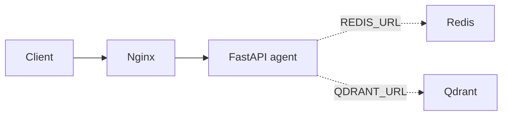

# Lab 14 — Mission Answers

## Part 1 — Localhost và production

| Vấn đề trong bản develop | Thay đổi ở bản production | Tác dụng |
| --- | --- | --- |
| Key đặt trực tiếp trong [app.py dòng 17](01-localhost-vs-production/develop/app.py#L17) | Đọc key từ [config.py dòng 27](01-localhost-vs-production/production/config.py#L27) | Đổi key từ môi trường và dùng chung code qua các môi trường. |
| In key và nội dung câu hỏi ở [app.py dòng 33–34](01-localhost-vs-production/develop/app.py#L33) | Log có cấu trúc, ghi trường vận hành thay cho thông tin xác thực | Dễ lọc sự cố mà giảm dữ liệu nhạy cảm đi vào log. |
| Debug bật cố định ở [app.py dòng 21](01-localhost-vs-production/develop/app.py#L21) | `DEBUG` đọc từ env, mặc định tắt | Tránh reload ngoài môi trường phát triển. |
| Port 8000 cố định | Uvicorn đọc `settings.port` từ `PORT` | Platform có thể cấp cổng khi deploy. |
| Chỉ có route ứng dụng | Có `/health` và `/ready` | Load balancer và tiến trình giám sát biết khi nào gửi traffic hoặc khởi động lại. |
| Không có bước dọn tài nguyên lúc tắt | Dọn dẹp trong FastAPI lifespan | Request đang chạy có thời gian hoàn tất trước khi đóng kết nối. |

Chạy bản develop với `curl -i -X POST "http://127.0.0.1:18201/ask?question=Hello"` được `HTTP/1.1 200 OK` và trường `answer` từ mock. Ở bản production, kiểm tra riêng `GET /health` và `GET /ready` đều trả `HTTP/1.1 200 OK`.

## Part 2 — Docker

1. Base image của bản develop là `python:3.11`. Nó cung cấp Python và hệ điều hành nền.
2. Working directory là `/app`. Các lệnh sau đó chạy tương đối từ thư mục này.
3. Copy `requirements.txt` trước code để tái sử dụng layer cài thư viện khi chỉ sửa source.
4. `ENTRYPOINT` xác định chương trình chính. `CMD` cung cấp chương trình mặc định hoặc đối số mặc định cho `ENTRYPOINT`. Đối số truyền cho `docker run IMAGE ...` thay thế `CMD`.

Stage builder cài dependencies vào thư mục Python của người dùng bằng pip. Stage runtime dùng base slim và chỉ chép thư viện đã cài sang /home/appuser/.local cùng source cần chạy. Image runtime bỏ công cụ build và file tạm.



Compose khởi động Redis và Qdrant, chờ hai health check đạt, sau đó chạy agent và Nginx. Nginx là điểm vào của client. Hai URL nội bộ được truyền sẵn cho agent mẫu để cấu hình Redis và Qdrant. Endpoint `/ask` trong mẫu gọi mock trực tiếp.

Đợt chạy Compose và build image mẫu dừng do ổ dữ liệu Docker báo `read-only file system`. Chưa có số dung lượng cặp image develop/production hoặc HTTP qua Nginx để báo cáo.

## Part 3 — Cloud Deployment

Chọn Render vì Blueprint khai báo được cả agent Docker và Key Value. Trạng thái và phép kiểm tra public được ghi ở [DEPLOYMENT.md](DEPLOYMENT.md).

| Tệp | Cách khai báo |
| --- | --- |
| `06-lab-complete/render.yaml` | Blueprint khai báo web service và Key Value gói Free. Render sinh API key và lấy URL Redis nội bộ bằng `fromService`. Đường dẫn health check là `/health`. |
| `06-lab-complete/railway.toml` | Cấu hình Docker builder và health check cho một service theo cơ chế Config as Code cũ của Railway. Redis và biến của agent thuộc cấu hình dự án. Railway đã ngừng cho service mới chọn cơ chế này. |

Tài liệu nền tảng. [Render Blueprint](https://render.com/docs/blueprint-spec) · [Railway Config as Code](https://docs.railway.com/config-as-code)

### Cloud Run CI/CD

1. `cloudbuild.yaml` cài dependencies và chạy `pytest` ở bước `test`.
2. Bước `build` gắn tag theo commit SHA và `latest`, dùng image trước làm cache nếu có.
3. Bước `push` đưa cả hai tag lên registry. Bước `deploy` chọn image theo SHA để phát hành lên Cloud Run.
4. `service.yaml` mô tả container, biến môi trường và secret tham chiếu từ Secret Manager, giới hạn scale 1–10, concurrency 80 và các probe.

## Part 4 — API Gateway

API key phù hợp cho client dịch vụ có thể giữ bí mật. JWT trong mẫu được cấp ở `POST /auth/token`. Khi client gửi Bearer token, backend xác minh chữ ký và thời hạn rồi lấy thông tin người dùng để áp quota.

Rate limiter áp số request theo người dùng trong cửa sổ thời gian và trả 429 kèm `Retry-After`. Cost guard kiểm tra chi tiêu trước khi gọi LLM, ước tính số token input/output sau khi có câu trả lời rồi ghi nhận chi phí. Mẫu có ngưỡng ngày cho từng người dùng và toàn dịch vụ, cảnh báo khi gần hết. Hai cơ chế xử lý hai tình huống khác nhau. Nhiều câu ngắn có thể vượt giới hạn request, còn ít câu dài vẫn có thể vượt ngân sách.

### Kết quả gọi localhost

Bản develop nhận JSON `{"question":"Hello"}`. Hai request lần lượt thiếu header và gửi đúng `X-API-Key`.

```http
HTTP/1.1 401 Unauthorized
HTTP/1.1 200 OK
```

Bản production dùng Bearer token của tài khoản mẫu. Thiếu token trả 401. Mười request có token trả 200. Trích output `curl -i` cho lần thứ 11.

```http
HTTP/1.1 429 Too Many Requests
x-ratelimit-limit: 10
x-ratelimit-remaining: 0
retry-after: 59

{"detail":{"error":"Rate limit exceeded","limit":10,"window_seconds":60,"retry_after_seconds":59}}
```

## Part 5 — Scaling và Reliability

| Exercise | Cách hoạt động |
| --- | --- |
| 5.1 Health checks | `/health` dùng để kiểm tra process còn sống. `/ready` báo instance đã khởi tạo xong và còn sẵn sàng nhận traffic. |
| 5.2 Graceful shutdown | Khi có SIGTERM, ngừng nhận traffic mới, chờ request đang chạy hoàn thành, sau đó đóng tài nguyên. Việc cho load balancer đủ thời gian cập nhật readiness giúp giảm gián đoạn trong rolling deploy. |
| 5.3 Stateless | Nếu history nằm trong RAM, mỗi replica chỉ biết phần nó từng xử lý. Redis giữ lịch sử theo session ID để replica khác đọc tiếp. |
| 5.4 Load balancing | Nginx phân phối `POST /chat` cho các agent. Trường `served_by` cho biết container xử lý request. |
| 5.5 Test stateless | Gửi năm câu trong cùng session rồi đọc history. Lịch sử dự kiến có năm câu hỏi và năm câu trả lời. |

Bản develop chạy trên localhost trả 200 cho `/health` và `/ready`.

Test ba replica của Exercise 5.4–5.5 chưa chạy xong vì Docker không ghi được ổ dữ liệu.

## Part 6 — Production-ready agent

Agent dùng một sliding window 60 giây theo API key. Redis thực thi cả bước kiểm tra và cập nhật bằng một thao tác nguyên tử, nhờ đó hai worker không thể cùng nhận slot cuối. Key trong Redis chứa hàm băm của API key. Ngân sách dùng chung theo ngày UTC và chi phí được tính xấp xỉ từ số ký tự. Guard kiểm tra tổng đã ghi trước khi gọi mock, nên các request đang xử lý đồng thời có thể làm tổng vượt ngưỡng trước khi lần kiểm tra tiếp theo chặn request. `/ready` thử ping Redis và trả 503 nếu Redis lỗi. `/health` tiếp tục trả 200. Uvicorn xử lý SIGTERM, chờ request rồi gọi lifespan để đóng pool của worker.

Chạy nguyên script chấm trong Linux với Redis thật. Image build xong và được script đo **238 MB**. Runtime dùng hai worker, lần thử SIGTERM trả HTTP 200 và process thoát mã 0. Hai mục Docker bị ảnh hưởng khi Docker Engine báo `read-only file system` ở bước tạo container kiểm thử.

```text
  📋 Checklist Deliverable
     ❌ Dockerfile (multi-stage, < 500 MB)
     ✅ docker-compose.yml (agent + redis)
     ✅ .dockerignore
     ✅ Health check endpoint (GET /health)
     ✅ Readiness endpoint (GET /ready)
     ✅ API Key authentication
     ✅ Rate limiting
     ✅ Cost guard
     ✅ Config từ environment variables
     ✅ Structured logging
     ❌ Graceful shutdown
     ✅ Public URL ready (Railway / Render config)
----------------------------------------------------------------
  Result: 10/12 tiêu chí đạt · 42/44 checks passed
```

## AI log

- Yêu cầu Codex thực hiện Lab 14 theo repo được cung cấp. Codex đọc đề, triển khai Part 6, thêm histogram, bổ sung knowledge base, chạy thử nghiệm và tổng hợp báo cáo từ bằng chứng thực thi.
- Số liệu và output trong bài đến từ các lệnh chạy trong workspace. Học viên cần tự đọc code và chạy lại các kiểm tra trước khi nộp để có thể giải thích từng phần.
